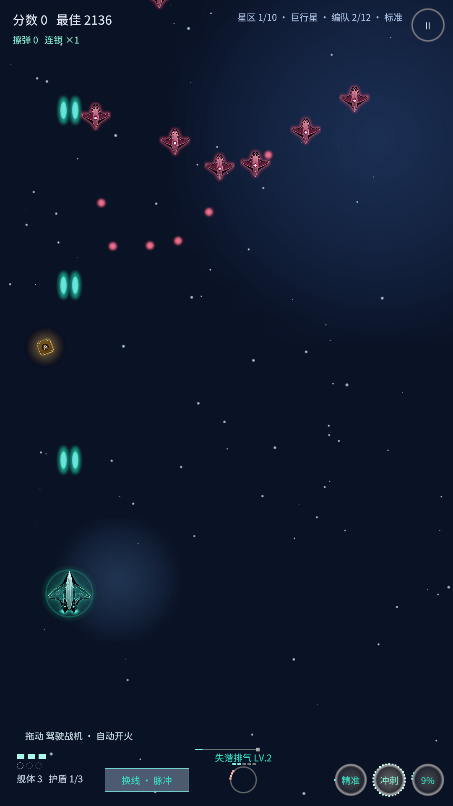
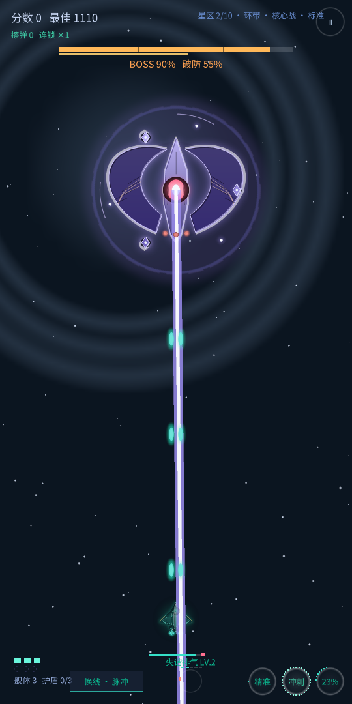
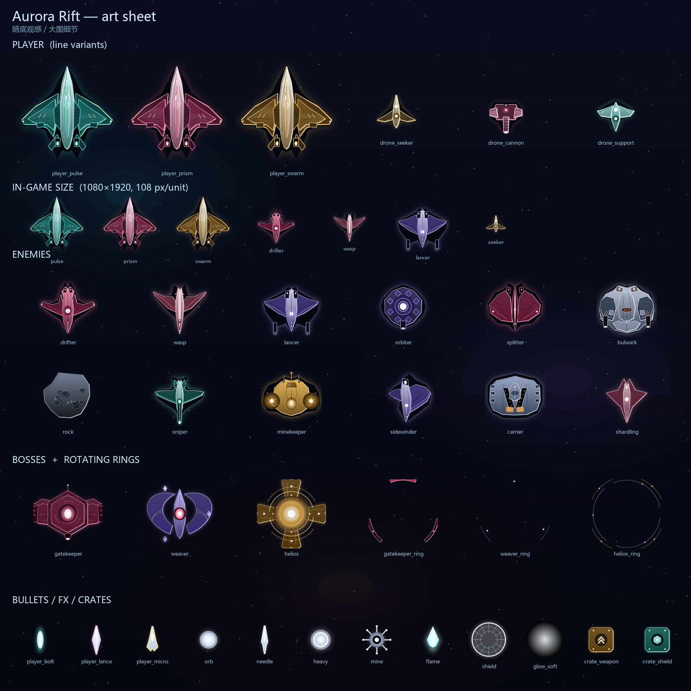

# 太空战斗机 · Aurora Rift — Unity 6 重制版

把网页版《太空战斗机 · Aurora Rift》用 Unity 6 重做的竖屏弹幕射击。Android APK 优先，桌面版用于快速验证与截图。

<p>
  
  
  
</p>

## 这一版的重点

- **特性对齐网页版 v2.8.4**：像素比例（画布 540 宽）、视口边界、星区剧本、Boss 光束与分时出招、
  开局配置、掉落与保底、界面四层与动作环热区，全部按 `space-fighter/www/js/` 源码逐条抄，
  并由 `VerifyNumbers` 278 条数值断言守住。
- **舰船美术全部独立绘制**：玩家三条武器线三套涂装、12 种敌机、3 类僚机、3 台 Boss、7 类弹体、补给箱；金属渐变、装甲倒角、面板刻线、自发光引擎，不再是几何占位图。
- **3 台 Boss 各自独立**：Gatekeeper / Weaver / Helios，本体 + 旋转环 + 呼吸光环 + 核心辉光；受击只闪外圈，持续输出不会把机体洗成灰白。
- **完整玩法**：三条武器线（蓄能 / 失谐 / 共鸣 / 换线）、擦弹与相位穿弹、冲刺、星爆 NOVA、棱镜力场、过载、三档难度、10 个星区、Boss 22 招、破防与临界、僚机编队、掉落保底。
- **手机上全部可点**：精准 / 冲刺 / 星爆三枚动作环 + 武器胶囊换线 + 右上暂停，画得出的都点得到。
- **安卓中文 HUD**：随包带 Noto Sans CJK SC 子集字体（942 字形 / 274KB），修复了旧版手机上 IMGUI 中文整段空白的问题。
- **纯代码搭场景**：仓库不提交场景/预制体，`GameBootstrap` 运行时建相机、玩家、HUD、弹池、导演与星空；CLI 一条命令出包。

## 下载

到 [Releases](https://github.com/sctale/SpaceFighter-Unity/releases/latest) 下载：

- `AuroraRift-Unity-v0.16.0.apk`（Android Debug 签名，安装时允许“未知来源”即可）

桌面版：`Builds/Windows/SpaceFighter.exe`（Unity 构建产物，本地生成）。

更新记录见 [`CHANGELOG.md`](CHANGELOG.md)。

## 操作

| 动作 | 桌面 | 触屏 |
|---|---|---|
| 移动 | 鼠标拖动 / 方向键 / WASD | 按住拖动（抓取偏移 + 抬升，单指锁定） |
| 精准模式 | 按住 `Shift` / `Ctrl` | 按住右下「精准」环 |
| 冲刺穿弹 | `空格` | 点「冲刺」环 |
| 星爆 NOVA（满 100） | `X` / `J` | 点「星爆」环 |
| 切换武器线 | `1` 脉冲 / `2` 棱镜 / `3` 蜂群 | 点「换线」胶囊循环 |
| 棱镜力场（1 护盾，8 秒吞弹 + 挡一次致命） | `Q` / 鼠标右键 | 拾取力场箱自动生效 |
| 暂停 | `P` / `Esc` | 右上角 `II` |
| 重开 | 阵亡后点击 / `R` | 点击 |

调试参数：`-zone N` 指定起始星区；`-boss` 直接进 Boss 战；`-shots -autoshot -tag xxx` 定时截图到 `docs/shots`；
`-dump` 打印当前所有在画的 `SpriteRenderer`（抓"界面上多出个东西"）；`-rebuild` 自检「重新开始」链路。

## 构建

环境：Unity **6000.3.10f1**、Android SDK、NDK **27.2.12479018**、JDK 17（Unity 自带即可）。

```bash
# 数值门禁（81 条断言，构建前必跑）
Unity.exe -batchmode -quit -projectPath <project> \
  -executeMethod AuroraRift.EditorTools.VerifyNumbers.Run

# Windows
Unity.exe -batchmode -quit -projectPath <project> \
  -executeMethod AuroraRift.EditorTools.BuildScript.BuildWindows

# Android：先导出 Gradle 工程，再用本地 Gradle 出 Release APK
Unity.exe -batchmode -quit -projectPath <project> -buildTarget Android \
  -executeMethod AuroraRift.EditorTools.BuildScript.ExportAndroidProject
# 导出后把 Builds/AndroidProject/gradle.properties 里的 -Xmx0M 改成 -Xmx4g，
# 用 Unity 自带 OpenJDK17 + gradle-launcher 跑 assembleRelease。
```

### 重新生成美术

```bash
python artgen/gen_ships.py     # 输出到 Assets/Resources/Ships/*.png
python artgen/preview.py       # 输出 artgen/preview.png 总览图
```

设计语言、尺寸约定、受击遮罩与导入设置见 [`docs/PORTING.md`](docs/PORTING.md)。

### 重新生成 HUD 中文字体

```bash
# 需要 fonttools；字体源用安卓系统的 NotoSansCJK-Regular.ttc（OFL）
python artgen/gen_font.py <path-to-NotoSansCJK-Regular.ttc>
```

## 目录

```
Assets/Scripts/      # 核心循环、实体、Boss、导演、HUD、视觉层
Assets/Editor/       # CLI 构建、数值门禁、舰船贴图导入规则
Assets/Resources/    # Ships（程序化生成的舰船 PNG）与字体子集
artgen/              # Python 美术生成器 + 字体子集脚本 + 预览图
docs/                # 重构对照表、使用说明、验收截图
```

## 已知限制

- 背景/星空仍是简化实现，原版 `background.js` 的逐层视差尚未完全复刻。
- 移动端目前只有「拖动移动 + 精准环」两套触控；切武器 / NOVA / 力场仍是键盘键位。
- APK 使用 Android Debug 签名，只适合个人/家庭安装；上架应用商店需换正式 keystore。

## License

代码与美术：Apache License 2.0，见 [LICENSE](LICENSE)。
HUD 字体：Noto Sans CJK SC 子集，SIL Open Font License 1.1，见 [Assets/Resources/Fonts/README-FONT.txt](Assets/Resources/Fonts/README-FONT.txt)。
