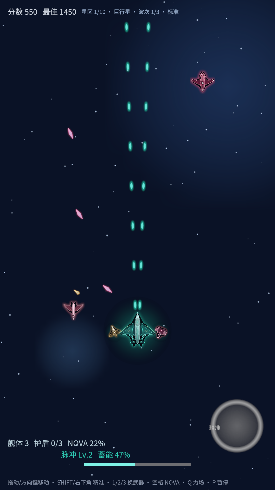
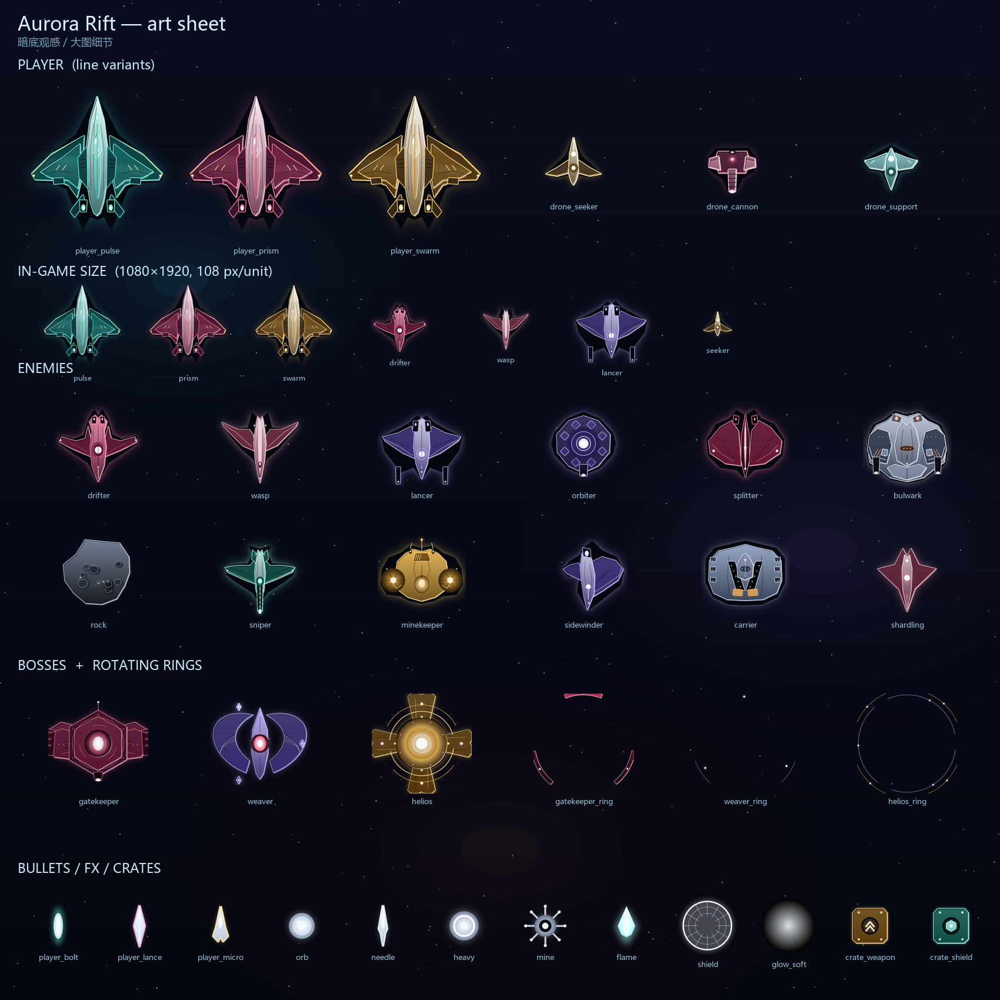

## 舰船美术专项

- 玩家三条武器线各一套独立涂装；12 种敌机、3 类僚机、3 台 Boss、7 类弹体、4 类补给箱全部换成独立程序化精灵。
- Boss：本体 + 独立旋转环 + 呼吸光环 + 核心辉光；受击只闪外圈，持续输出不会洗掉涂装。
- 安卓 IMGUI 中文 HUD 整段空白的修复：随包带 Noto Sans CJK SC 子集字体。

## 安装

- 附件：`AuroraRift-Unity-v0.15.0.apk`
- Android 8.0+（minSdk 25），arm64-v8a，Android Debug 签名

## 验证

- `VerifyNumbers` 81/81 通过。
- APK `versionName=0.15.0`、`versionCode=15`，V2 签名校验通过。
- 已在 Android 16 模拟器 1080×1920 安装运行。

## 已知限制

- 背景/星空仍是简化实现，逐层视差待补。
- 移动端目前只有「拖动移动 + 精准环」；切武器 / NOVA / 力场仍为键盘键位。
