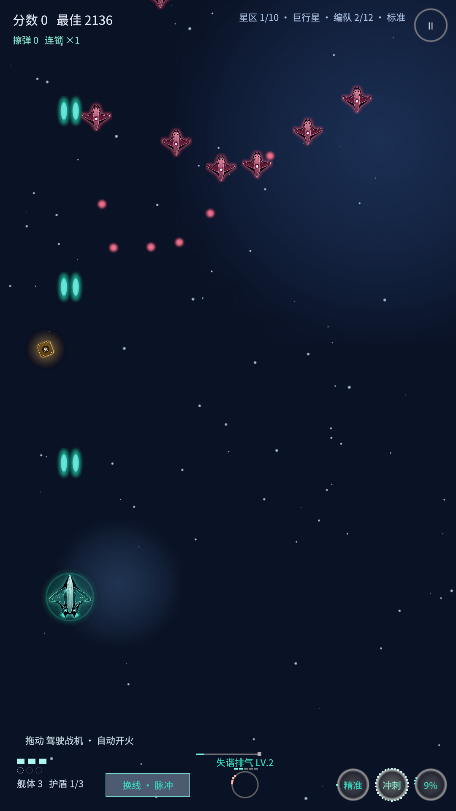
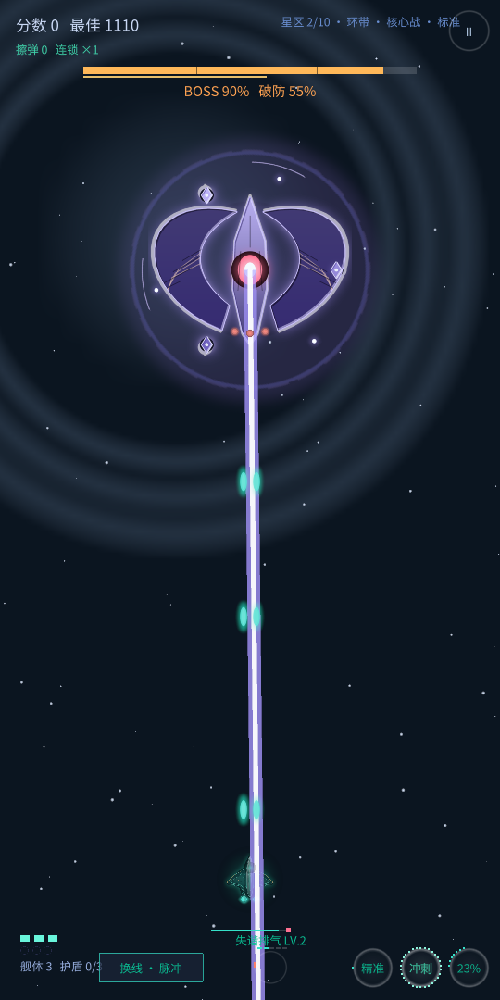

## 完全对标网页版 v2.8.4

这一版不叠新美术，只把 Unity 版拉回网页版的特性与手感，并修掉真机上暴露的问题。
所有数值按 `space-fighter/www/js/` 源码逐条抄，由 278 条断言守住。

### 比例与视口（"画面别扭"的根因）

- 像素→世界单位 `1/40` → `10/540`：网页版画布宽度固定 540px，之前整体放大了 1.35 倍。
- 新增 `GameView` 统一供给实时视口：移动区、生成/消失线、复活点、敌机悬停高度、星空循环、
  弹雨落点、Boss 悬停点与入场点。20:9 长屏不再"Boss 悬在画面中间"。

### 玩法

- **星区剧本**：一个星区 12~17 条固定编队脚本（V 字/横排/弧/钳形/狙击巢/雷线/母舰群）逐条触发，
  放完清场、清完出 Boss；剧本内嵌武器强化、中期补给、僚机箱。替换原来的"随机编队 + 三波"。
- **Boss 光束实体**：warn 虚线预告 → active 判定 → 收尾，扫射光束带旋转；不再用子弹近似。
- 招式内分时发射（原版 `at(t)` 队列）、二阶段起招式间隙补针弹。
- 开局：护盾 1 层、**没有僚机**、只有脉冲线解锁（2 级）。
- 冲刺穿弹、相位擦弹、力场反弹、星爆过载、失谐/共鸣、连锁倍率、破防槽、精准模式压缩判定。
- 切后台/失焦自动暂停并清触屏状态。

### 界面

- 四层：开始菜单（三档难度可点）/ 战斗仪表带 / 暂停设置 / 结算（10 项数据 + 评级 + 差值）。
- 右下三枚动作环：精准 / 冲刺 / 星爆，命名与教学一致，热区与绘制同源。
- 按钮改为"半透明面板 + 描边"，难度名居中并留内缩（修掉首字被裁）。
- 进度轨：剧本 0~86% / 清场 96% / Boss 100%。

### 修复

- **安卓 HUD 整层不画**：`Strip Engine Code` 把原生 `MonoBehaviour`(class 115) 剥掉，
  `AddComponent` 与 IMGUI 画字每次都重建 `RuntimeTextSettings`，`GUI.DoSetSkin` 每帧 NRE
  （30 秒 2.5 万条日志）。关闭引擎裁剪 + `Assets/link.xml`，真机复测异常数 0；包体 +6.4MB。
- **「重新开始」黑屏**：`LoadScene` 后引导对象不再 `Awake`，改为拆树原地重建。
- 受击时 `ArgumentOutOfRangeException`：`TakeHit()` 内清屏把正在遍历的弹列表改短。
- 开始界面中间停着两架无人管理的僚机。
- IL2CPP 需要把 `TMP/TEMP` 指到干净目录。

## 安装

- 附件：`AuroraRift-Unity-v0.16.0.apk`
- Android 8.0+（minSdk 25），arm64-v8a，Android Debug 签名（与 v0.15.0 同一证书，可直接覆盖安装）

## 验证

- `VerifyNumbers` 278/278 通过。
- APK `versionName=0.16.0`、`versionCode=16`、`native-code arm64-v8a`，V2 签名校验通过。
- Android 16 模拟器 1080×1920 安装运行：菜单 / 实战 / 受击 / 暂停 截图，`logcat -s Unity:E` 异常计数 0。
- Windows 版 `-shots -rebuild` 自检：重建后 `GameRoot` / 玩家 / 相机 / 导演全部在线。

## 已知限制

- 触感震动未接（网页版走 Capacitor `haptic`，Unity 需要 Android 震动插件）。
- 背景/星空仍是各星区独立主题的简化实现，逐层视差待补。
