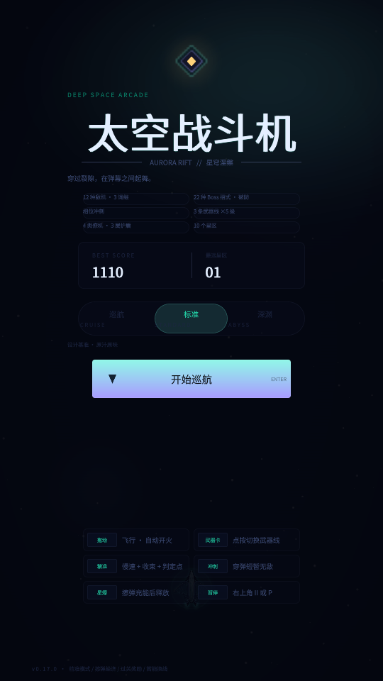
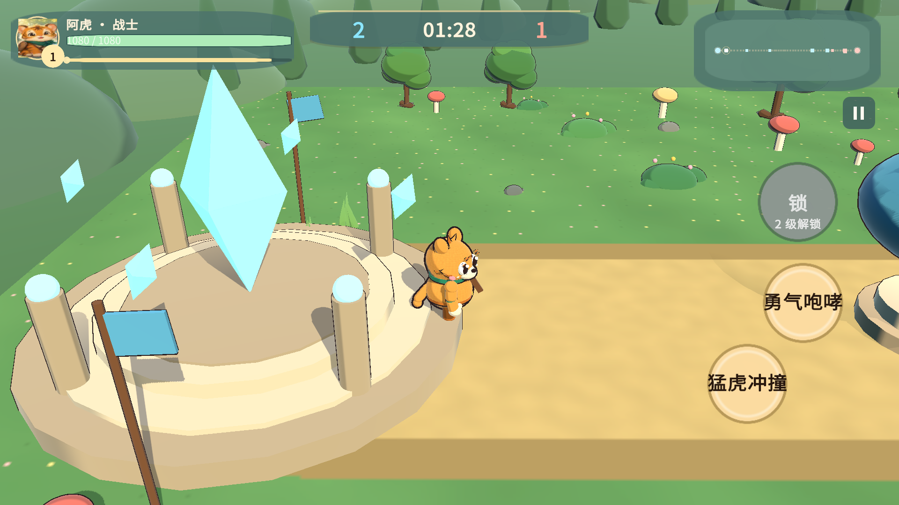

## 界面重做 + 难度对齐 + 应用图标

上一版把玩法数值对齐了网页版，这一版解决"看起来不像同一个游戏"的问题。

### 界面（照 `web/www/css/game.css` 重画）

- 新增 `UI/UiKit.cs`：运行期生成圆角面板、胶囊、环形充能弧、菱形/六角/三角徽标、
  渐变、扫描线与暗角——IMGUI 也能画出网页版那种玻璃面板质感。
- **开始菜单**：品牌菱形标记 + `DEEP SPACE ARCADE` 题头 + 渐变辉光大标题 +
  `AURORA RIFT // 星穹涅槃` + 6 枚特性胶囊 + 战绩卡 + 三档难度（带 EN 副标）+
  `开始巡航` 渐变按钮 + 6 条操作提示 + 版本页脚。
- **战斗 HUD**：`SCORE` 题头 + 大分数 + BEST/GRAZE；中上 `SECTOR` + 星区名；右上圆形暂停键；
  右侧 ×倍率 / CHAIN / 进度条；`THREAT` Boss 卡（名字 + 称号//英文 + 阶段徽章 + 四段刻线血条 +
  破防槽 + 蓄招名）；底部仪表带（5 格舰体三角 + 3 格护盾六角 + 武器胶囊 + 星区进度轨 + 三枚动作环）。
- **暂停页**：`SYSTEM HOLD` + 装配胶囊 + 三行开关 + 继续/重开/返回基地 + 快捷键。
- **结算页**：`RUN TERMINATED` + 分数卡 + 评级圆章（S/A/B/C）+ 新纪录 + 十项数据卡片 + 明细。

### 流程

- 公告改成 `announce(title, sub, {alert, duration, bottom})`：星区开场、`WARNING`、Boss 登场、
  `PHASE n`、`CORE BREAK`、`OVERLOAD`、`CORE BREACH`、`HULL BREACH`、`SIGNAL LOST`。
- 清场后先亮 2.4 秒 `WARNING` 再出 Boss；「返回基地」回菜单而不是重开一局。
- 提示气泡与吐司抬到仪表带上方，不再压住战机。

### 难度（逐条照 `entities.js`）

- 敌弹速度补上缺失的 tier 项：`min(300, 150×(1+tier×0.14)) × 难度`。
- 扇形 3/5 发、环爆 10/14、散射 2 发 ±0.32、重弹 3 发（精英加 2 发等离子）、
  针弹 3/5 发 ×330px/s、水雷 3/4 颗（引信 1.8~2.4s 分裂 10）、波动弹 2 发 + 1 针、母舰 2 发。
- 敌机移速 ×(1+tier×0.14)（之前误乘血量倍率）；开火前摇 0.9~1.6s；只在画面 80% 高度以上开火；
  航母每 2.6~3.6 秒召唤幼体。

### 图标

- `artgen/gen_icon.py` 生成 1024 母图与自适应图标前景/背景；
  构建时 `PlayerSettings.SetIcons`，导出后写入 `mipmap-anydpi-v26/app_icon.xml`。

## 安装

- 附件：`AuroraRift-Unity-v0.17.0.apk`
- Android 8.0+（minSdk 25），arm64-v8a，Android Debug 签名（与 0.16 同证书，可直接覆盖安装）

## 验证

- `VerifyNumbers` **281/281**（新增敌弹速度/移速随 tier 的三条断言）。
- 安卓 16 模拟器 1080×1920：菜单 / 实战 / 暂停 / 结算截图，`logcat -s Unity:E` 异常 0。
- 桌面图标为自适应图标（菱形环 + 舰船），不再是白底方块。

## 已知限制

- 触感震动未接（网页版走 Capacitor `haptic`，Unity 需安卓震动插件）。
- 背景/星空仍是各星区独立主题的简化实现，逐层视差待补。
